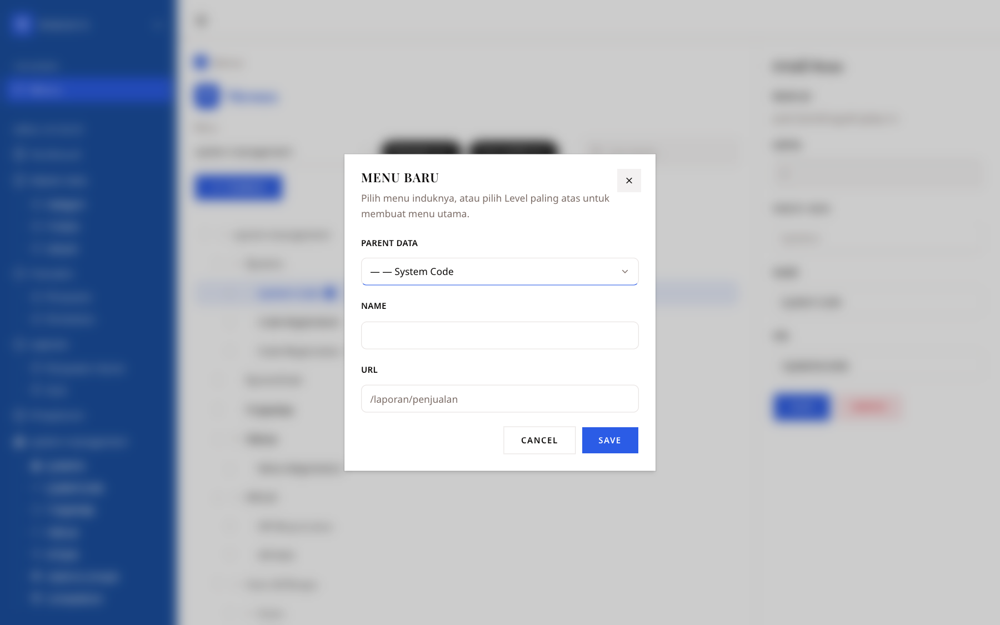

# Technical Test - Fullstack Menu Management

Aplikasi pengelolaan menu bertingkat (parent - child) dengan REST API dan antarmuka web.
Menu bisa ditambah, diubah, dihapus, dan dipindahkan antar level lewat drag and drop.

Repo ini berisi dua aplikasi:

| Folder | Isi | Dokumentasi |
| --- | --- | --- |
| `backend/` | REST API, Go + Fiber v3 + GORM + PostgreSQL | [backend/README.md](backend/README.md) |
| `frontend/` | Antarmuka web, Next.js + TanStack Query + Zustand + shadcn/ui | [frontend/README.md](frontend/README.md) |

## Fitur

**Menu (CRUD + hierarki)**

- Menampilkan menu bertingkat dengan expand/collapse per node.
- Menambah menu di level mana pun (induk dipilih dari dropdown).
- Mengubah nama dan URL menu lewat form dengan validasi.
- Menghapus menu dengan konfirmasi; submenu di bawahnya ikut terhapus (cascade).
- Mencari menu berdasarkan nama, tanpa memutus hierarkinya.

**Drag and drop**

- Mengurutkan ulang menu dalam satu level.
- Memindahkan menu ke induk lain, termasuk ke level paling atas.
- Menu tidak bisa dipindahkan ke dalam submenu-nya sendiri (dicek di frontend dan backend).

**Lain-lain**

- Dokumentasi API (OpenAPI 3) dengan Swagger UI di `/docs`.
- Loading state, error state dengan tombol coba lagi, dan notifikasi untuk setiap aksi.
- Responsive: di layar kecil panel detail menempel di bawah dan sidebar menjadi panel geser.

## Tangkapan layar

| Halaman menu (desktop, 1440x900) | Dialog tambah menu |
| --- | --- |
|  |  |

| Panel detail (mobile, 390x844) | Sidebar (mobile) |
| --- | --- |
|  |  |

## Menjalankan

Prasyarat: Go 1.27+, Bun (atau Node.js 20+), dan database PostgreSQL.

### Satu perintah untuk keduanya

```bash
./dev.sh
```

Menyalakan backend dan frontend sekaligus: menunggu backend siap dulu, memberi prefiks
`[backend]` dan `[frontend]` pada log, dan menghentikan keduanya saat Ctrl+C ditekan.
Port yang sudah dipakai proses lain dilaporkan beserta nama dan PID prosesnya.

```bash
PORT=8080 ./dev.sh              # paksa port backend
FRONTEND_PORT=3001 ./dev.sh     # paksa port frontend
```

Kalau ingin sekaligus menjalankan database, pakai Docker: `docker compose up --build`.

### Atau dua terminal terpisah

```bash
# 1. Backend
cd backend
cp .env.example .env      # isi DATABASE_URL dengan koneksi PostgreSQL
go run .
# migration jalan otomatis saat server start
# Swagger UI: http://localhost:4000/docs

# 2. Frontend (terminal terpisah)
cd frontend
cp .env.example .env.local   # NEXT_PUBLIC_API_URL harus sama dengan PORT di backend/.env
bun install
bun dev
# http://localhost:3000
```

Isi data contoh (opsional):

```bash
cd backend
python3 seed/push.py --url http://localhost:4000
python3 seed/push.py --url http://localhost:4000 --file menus-dari-brief.json
```

## Menjalankan dengan Docker

### Development (hot reload kedua aplikasi)

```bash
docker compose up --build
```

Yang jalan di dalam stack ini:

| Service | Isi |
| --- | --- |
| `database` | PostgreSQL 18, datanya disimpan di volume `database-data` |
| `backend` | Go + air; folder `backend/` di-mount, server restart otomatis saat berkas `.go` berubah |
| `frontend` | Next.js dev; folder `frontend/` di-mount, halaman dimuat ulang saat berkas berubah |

Frontend: http://localhost:3000 · Backend: http://localhost:4000 · PostgreSQL: `localhost:5432`

Nilai seperti nama/password database dan port di komputer bisa diubah lewat berkas
`.env` di folder ini (contohnya di `.env.example`). Port host perlu diubah kalau
sudah dipakai proses lain:

```bash
BACKEND_PORT=4001 FRONTEND_PORT=3100 NEXT_PUBLIC_API_URL=http://localhost:4001 docker compose up -d
```

Kalau frontend dibuka lewat IP/domain (bukan `localhost`), Next memblokir permintaan ke
sumber daya dev (HMR) dan hot reload tidak jalan. Daftarkan host-nya di `.env` —
tanpa `http://` dan tanpa port, dipisah koma kalau lebih dari satu. Nilai
bawaannya `stk.santosatechid.cloud`:

```bash
ALLOWED_DEV_ORIGINS=stk.santosatechid.cloud docker compose up -d
```

> Perintah di README ini memakai `docker compose` (plugin). Kalau CLI-mu belum
> mengenalinya, pakai `docker-compose` — perintahnya sama.

> **Hot reload di macOS.** Docker Desktop sudah meneruskan perubahan berkas dari
> komputer ke container. Kalau memakai **colima**, set `mountInotify: true` di
> `~/.colima/default/colima.yaml` lalu jalankan ulang colima; tanpanya perubahan
> berkas tidak terdeteksi di dalam container — hot reload frontend tidak jalan,
> sedangkan backend tetap jalan karena air memeriksa berkas secara berkala
> (`poll = true` di `backend/.air.toml`).

```bash
docker compose logs -f backend    # lihat log satu service
docker compose down               # hentikan (data database tetap ada)
docker compose down -v            # hentikan dan hapus data database
```

### Production (multi-stage build)

```bash
docker compose -f docker-compose.prod.yml up --build -d
```

Bedanya dengan mode development: image dibangun lewat `Dockerfile` (multi-stage),
frontend memakai output `standalone`, tidak ada source code yang di-mount, dan tidak
ada hot reload.

**Satu origin, lewat reverse proxy di host.** Frontend dan API dilayani dari alamat
yang sama, jadi browser tidak pernah memanggil port backend langsung dan CORS tidak
dipakai sama sekali. Karena itu kedua port container hanya dibuka di `127.0.0.1`:

```
internet → reverse proxy di host (TLS)      container
   ├─ /      →  127.0.0.1:4001  ───────────  frontend
   └─ /api/  →  127.0.0.1:4000  ───────────  backend → database
```

Aturan nginx di host (Caddy/Traefik sama saja):

```nginx
location /      { proxy_pass http://127.0.0.1:4001; }
location /api/  { proxy_pass http://127.0.0.1:4000; }
# opsional, kalau dokumentasi API mau dibuka dari luar:
location /docs  { proxy_pass http://127.0.0.1:4000; }
```

Frontend dibuild dengan `NEXT_PUBLIC_API_URL` **kosong**, artinya request ke `/api/...`
diarahkan ke origin halaman itu sendiri. Jadi jangan diisi `http://localhost:4000`:
alamat itu dibaca browser pengunjung, bukan server.

Kalau reverse proxy-nya jalan di dalam Docker (bukan di host), sambungkan container
proxy itu ke network compose ini (`external: true` pada network yang sama) atau ubah
bind port-nya dari `127.0.0.1:` menjadi tanpa alamat.

Hal lain:

- **Healthcheck dan urutan start.** Backend menunggu database sehat, frontend menunggu
  backend sehat; `docker compose -f docker-compose.prod.yml ps` menampilkan statusnya.
  `/health` dipakai backend sebagai patokan.
- **`NEXT_PUBLIC_API_URL` ditanam saat build**, karena nilainya dibaca browser. Kalau
  alamatnya berubah, image frontend harus dibangun ulang:
  `docker compose -f docker-compose.prod.yml build frontend`.
- **Log container dibatasi** 10 MB × 3 berkas per service (`docker compose logs` tetap
  membacanya), supaya disk server tidak penuh.
- **Data database ada di volume `database-data`.** `docker compose down -v` akan
  menghapusnya.
- **Password database bawaannya `menu`.** Database tidak terbuka ke luar container,
  tapi tetap ganti `POSTGRES_PASSWORD` di `.env` kalau server ini bisa diakses orang lain.

## Konfigurasi

Backend (`backend/.env`, atau environment di compose):

| Variable | Wajib | Default | Keterangan |
| --- | --- | --- | --- |
| `DATABASE_URL` | ya | - | Koneksi PostgreSQL |
| `PORT` | tidak | `4000` | Port HTTP server |
| `CORS_ORIGINS` | tidak | kosong = semua origin | Origin yang boleh memanggil API dari browser, dipisah koma. Di produksi tidak perlu karena frontend dan API satu origin. |

Frontend (`frontend/.env.local`, atau argumen build di compose):

| Variable | Wajib | Default | Keterangan |
| --- | --- | --- | --- |
| `NEXT_PUBLIC_API_URL` | tidak | kosong = origin yang sama | Alamat backend dari sudut pandang browser. Diisi di dev (misalnya `http://localhost:4000`), dikosongkan di produksi. |
| `ALLOWED_DEV_ORIGINS` | tidak | - | Host yang dipakai membuka dev server selain `localhost`, dipisah koma. Hanya berpengaruh di mode development. |

## Ringkasan API

| Method | Endpoint | Keterangan |
| --- | --- | --- |
| GET | `/health` | Status server |
| GET | `/api/menus` | Semua menu (datar) |
| GET | `/api/menus/tree` | Menu bersarang |
| POST | `/api/menus` | Tambah menu |
| GET | `/api/menus/:id` | Detail satu menu |
| PUT | `/api/menus/:id` | Ubah menu |
| DELETE | `/api/menus/:id` | Hapus menu beserta submenunya |
| PATCH | `/api/menus/:id/move` | Pindah induk / ubah urutan (dipakai drag and drop) |

Dokumentasi lengkap: `http://localhost:PORT/docs` (sumbernya `backend/api.docs.yml`).

## Struktur database

Satu tabel `menus` dengan relasi ke dirinya sendiri:

| Kolom | Tipe | Keterangan |
| --- | --- | --- |
| `id` | TEXT | Primary key berupa CUID2 (24 karakter) yang dibuat aplikasi saat menambah menu |
| `parent_id` | TEXT NULL | Induk menu; `NULL` berarti level paling atas |
| `name` | VARCHAR(100) | Nama menu |
| `url` | VARCHAR(255) | Tujuan menu |
| `position` | INTEGER | Urutan tampil di antara menu dengan induk yang sama |
| `created_at`, `updated_at` | TIMESTAMPTZ | Waktu dibuat dan diubah (UTC) |

Schema ditentukan oleh file di `backend/database/migrations/`, dijalankan otomatis
saat server start dan dicatat di tabel `schema_migrations`.

## Test

```bash
cd backend  && go test ./...     # logika penomoran posisi dan penyusunan tree
cd frontend && bun run test      # logika pengolahan menu bersarang (vitest)
```

Pemeriksaan lain di frontend: `bun run lint`, `bunx tsc --noEmit`, `bun run build`.

## Performa

Yang sudah dikerjakan (sengaja sederhana dan bisa ditelusuri):

| Bagian | Yang dilakukan |
| --- | --- |
| Database | Index `(parent_id, position)`, dipakai saat mengambil submenu dalam urutan tampil |
| Backend | Tree disusun dari **satu** query di Go, bukan satu query per node; pindah/urutkan ulang dikerjakan dalam satu transaksi |
| Frontend | Data menu di-cache TanStack Query (`staleTime` 30 detik); sidebar dan halaman memakai query key yang sama, jadi hanya ada satu request |
| Frontend | Pencarian disaring di memori (tanpa request tambahan), dan hasilnya dihitung ulang hanya saat tree atau kata kunci berubah |
| Frontend | React Compiler aktif (bawaan Next 16) sehingga komponen di-memoize otomatis |
| Build | Output `standalone` membuat image produksi hanya berisi berkas yang dipakai |

Yang belum dikerjakan: virtualisasi daftar menu. Baru perlu kalau jumlah menu dalam
satu tampilan mencapai ribuan, dan menambah kompleksitas untuk kasus yang sekarang
belum ada.

## Keputusan teknis

- **Id menu berupa CUID2, dibuat aplikasi** (`github.com/nrednav/cuid2`), bukan angka
  berurut dari database. Id jadi aman ditampilkan di URL dan tidak membocorkan jumlah
  data. Karena id dibuat aplikasi, tabel `menus` dibuat ulang pada migration 0002
  (id `TEXT`), dan frontend memperlakukan id sebagai teks apa adanya.
- **Layer backend**: `route` (HTTP) → `service` (aturan bisnis) → `repository` (query).
  Hanya `repository` yang menyentuh GORM.
- **Schema dari file SQL, bukan AutoMigrate.** GORM dipakai untuk query; struktur tabel
  ditentukan file migration supaya terlihat dan bisa direview.
- **Satu endpoint untuk pindah dan urutkan ulang** (`PATCH /api/menus/:id/move`).
  Keduanya operasi yang sama: menaruh satu menu di posisi tertentu di bawah induk tertentu.
- **Data server dan state UI dipisah tegas di frontend.** TanStack Query memegang semua
  data dari server, Zustand hanya memegang state tampilan (menu terpilih, node terbuka,
  kata kunci pencarian). Tidak ada data menu yang disimpan di Zustand.
- **Validasi ditulis sekali** sebagai schema Zod, lalu dipakai form lewat react-hook-form.

Penjelasan lebih panjang ada di README masing-masing folder.
# STK-Technical-Test-Fullstack-Web
